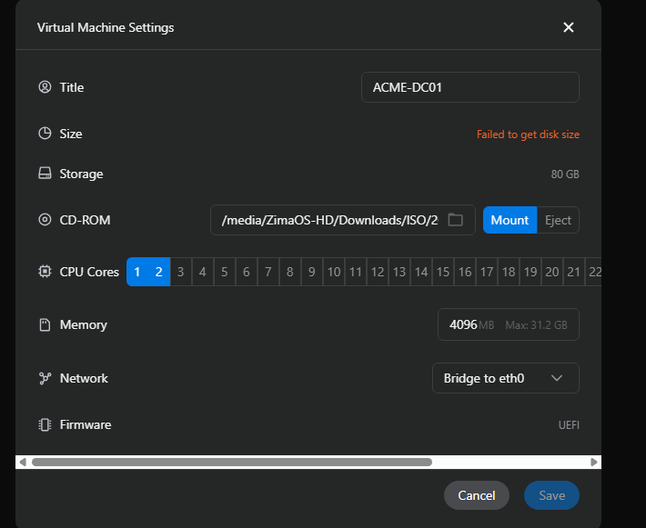
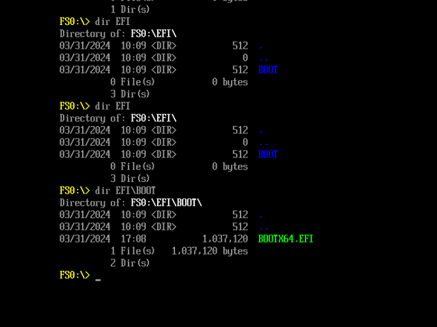
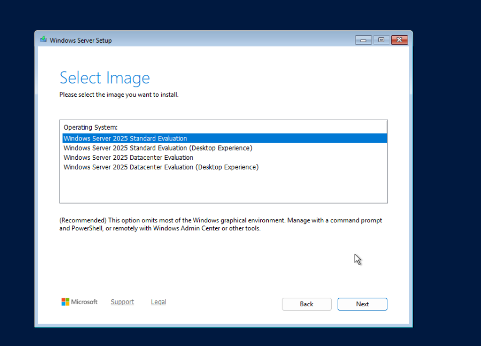
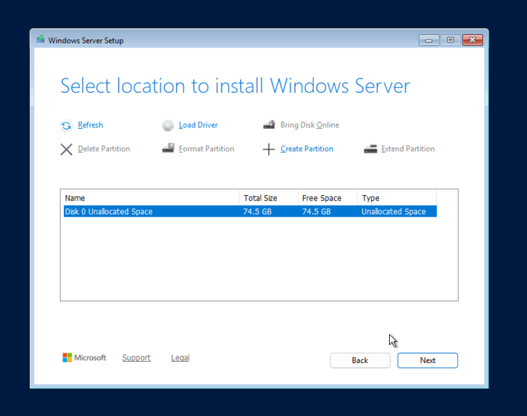
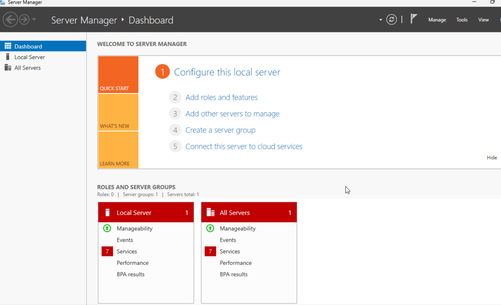
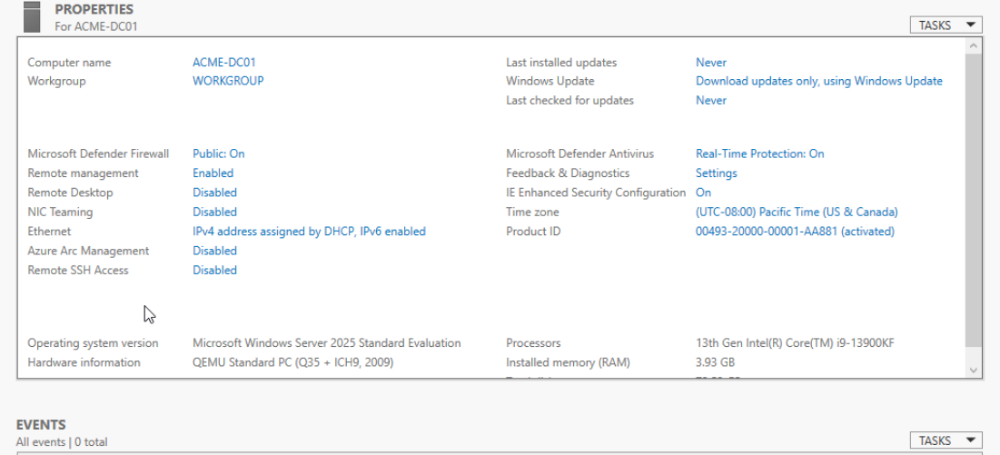

# 01 - Windows Server 2025 Setup

## Objective

Deploy a Windows Server 2025 virtual machine in ZimaOS using ZimaVM, configure the virtual hardware, complete the Windows installation, and prepare the server for the ACME Corporation Active Directory environment.

## Environment

| Component | Configuration |
|---|---|
| Virtualization host | ZimaOS (Intel-based, 32 GB host RAM) |
| VM management | ZimaVM |
| Server operating system | Windows Server 2025 Standard Evaluation (Desktop Experience) |
| Virtual machine name | `ACME-DC01` |
| Virtual CPU | 2 vCPUs |
| Virtual RAM | 4 GB (4096 MB) |
| Virtual disk | 80 GB allocated |
| Firmware | UEFI |
| Network connection | Bridged to `eth0` |

## 1. Configure the Virtual Machine

Created a new Windows Server virtual machine in ZimaVM, attached the Windows Server evaluation ISO, and assigned 2 CPU cores, 4096 MB of RAM, and an 80 GB virtual disk.

Selected UEFI firmware and a bridged `eth0` network adapter to connect the lab server to the existing network. This bridge is not an isolated network; the lab uses separate, explicitly configured Active Directory DNS settings rather than changing home-network-wide DNS.



## 2. Troubleshoot the UEFI Boot Process

During first boot, the virtual machine entered the UEFI Interactive Shell instead of automatically starting Windows Setup.

I inspected the mapped filesystem and found the EFI bootloader under `EFI\BOOT`:

```text
fs0:
dir EFI\BOOT
EFI\BOOT\BOOTX64.EFI
```

After launching the EFI bootloader, I responded to the CD/DVD boot prompt and started the Windows Server installer.



## 3. Install Windows Server

Chose **Windows Server 2025 Standard Evaluation (Desktop Experience)** to obtain the Windows graphical interface and Server Manager for hands-on administration.

The screenshot below shows the available editions in the installer *before the Desktop Experience option was selected*.



Selected **Disk 0 Unallocated Space**, which Windows Setup displayed as approximately **74.5 GB** for the provisioned 80 GB virtual disk. Allowed Windows Setup to create the required partitions automatically.



Completed installation, configured the built-in Administrator account with a private password, and signed in to Windows Server. Passwords are intentionally excluded from the repository.

## 4. Configure and Verify the Server

Opened **Server Manager** to confirm the Desktop Experience installation had successfully booted.



Renamed the server to `ACME-DC01`, restarted Windows Server, and verified the computer name in **Server Manager → Local Server**. The properties also confirmed Windows Server 2025 Standard Evaluation and the assigned memory.



## Networking Notes

The server was initially connected to the `10.0.0.0/24` home-lab subnet through bridged networking. The router assigned its IP using DHCP; a router-side DHCP reservation was subsequently configured to retain `10.0.0.194` for `ACME-DC01`.

Active Directory Domain Services and DNS setup are documented separately in **02 - Active Directory Configuration**. This VM deployment section does not cover promotion to a domain controller.

## Skills Demonstrated

- Creating and configuring VMs with ZimaVM
- Allocating virtual CPU, RAM, and storage
- Installing Windows Server 2025 with Desktop Experience
- Navigating UEFI boot troubleshooting
- Configuring bridged virtual networking
- Renaming and verifying a Windows Server installation
- Capturing installation evidence and documenting changes

## Outcome

Successfully deployed a Windows Server 2025 Standard Evaluation VM named `ACME-DC01` on ZimaOS, verified the Windows Server installation, and prepared it for the Active Directory domain deployment documented in the next section.
