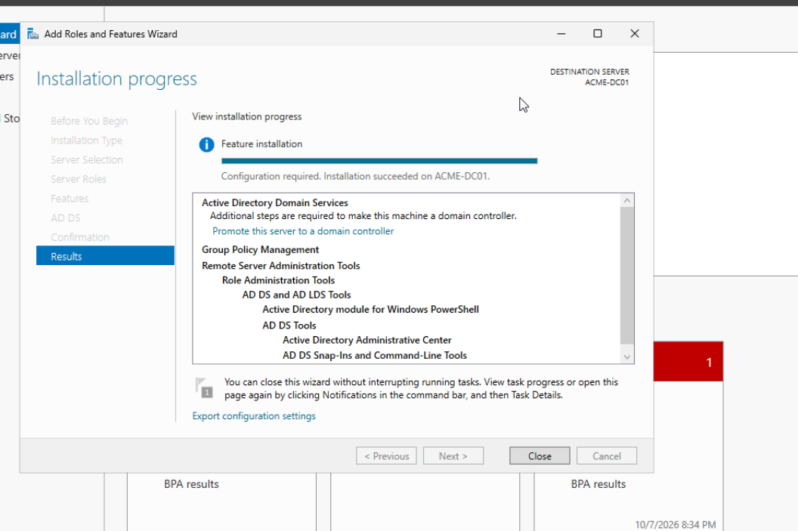
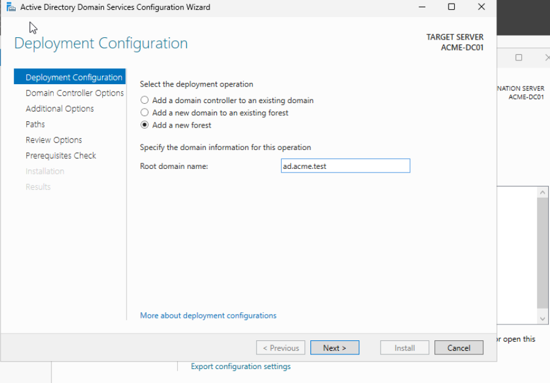
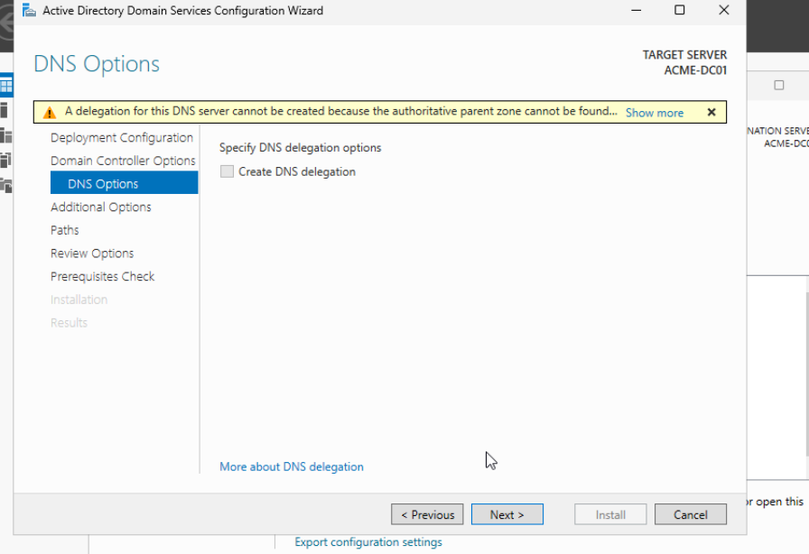
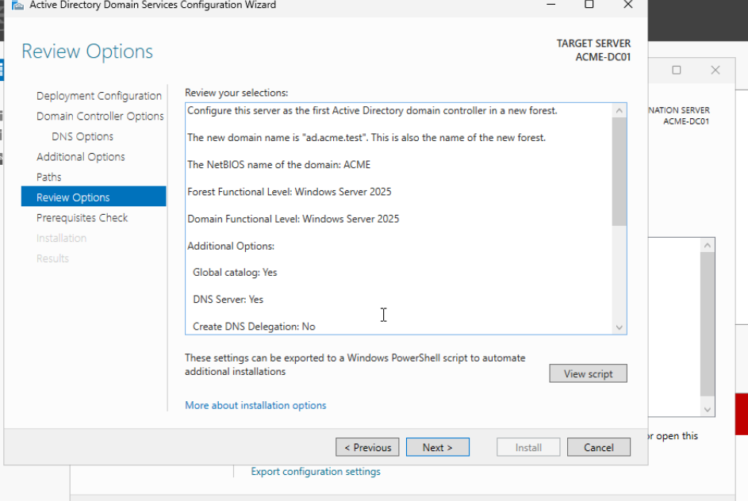
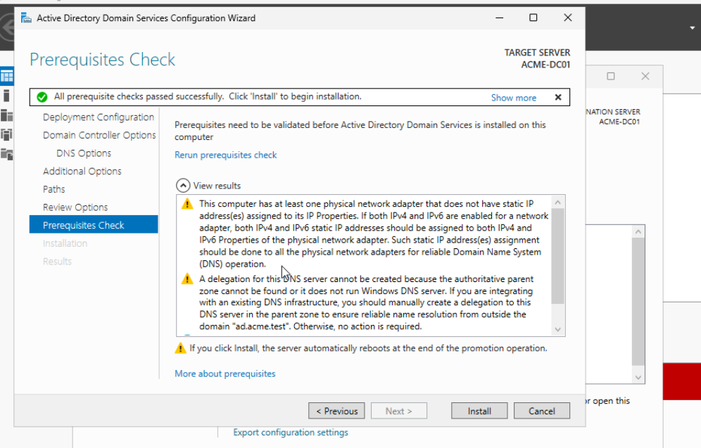
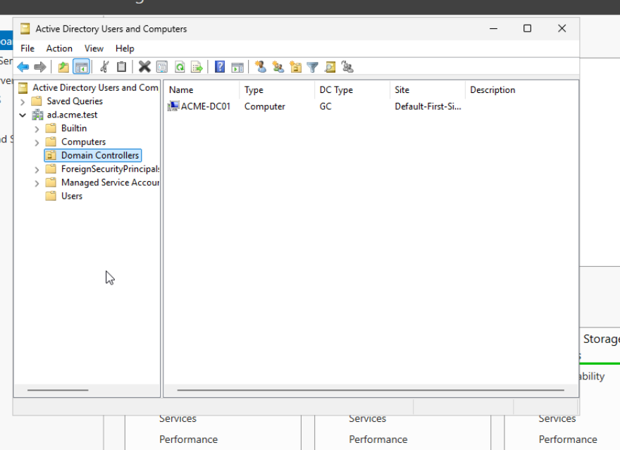
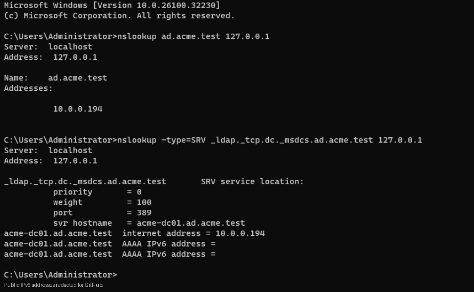
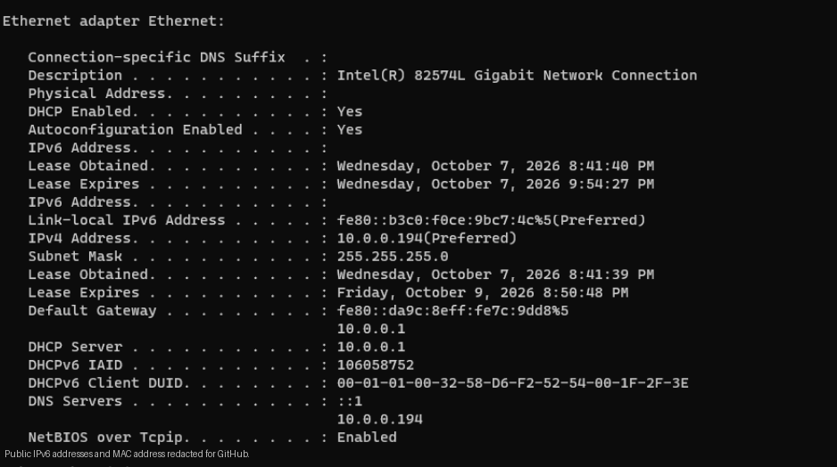
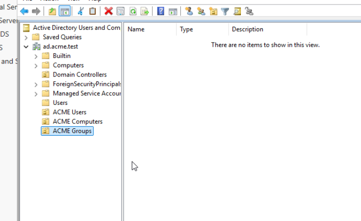
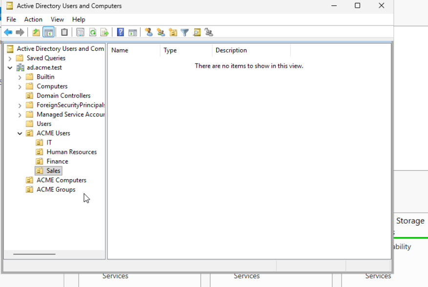

# 02 - Active Directory Configuration

## Objective

Install Active Directory Domain Services (AD DS) on the Windows Server 2025 VM, promote `ACME-DC01` to the first domain controller in a new forest, verify Active Directory DNS, and create an Organizational Unit (OU) structure for a simulated ACME Corporation environment.

## Environment

| Component | Configuration |
|---|---|
| Server | `ACME-DC01` |
| Operating system | Windows Server 2025 Standard Evaluation (Desktop Experience) |
| Domain / forest root | `ad.acme.test` |
| NetBIOS domain name | `ACME` |
| Forest / domain functional level | Windows Server 2025 |
| Domain controller IPv4 address | `10.0.0.194` |
| IPv4 allocation | DHCP with a router-side reservation |
| Network | `10.0.0.0/24`, bridged to `eth0` |
| DNS role | Windows Server DNS on `ACME-DC01` |
| Management tools | Server Manager, Active Directory Users and Computers, Command Prompt |

## 1. Install Active Directory Domain Services

In **Server Manager → Manage → Add Roles and Features**, selected **Role-based or feature-based installation** and installed **Active Directory Domain Services** with the required administration tools.

The role-installation wizard confirmed **Configuration required. Installation succeeded on ACME-DC01**, and offered the option to promote the server to a domain controller.



## 2. Create a New Active Directory Forest

In the **Active Directory Domain Services Configuration Wizard**, selected **Add a new forest** and entered `ad.acme.test` as the root domain name.



Selected the Windows Server 2025 forest and domain functional levels, enabled **DNS Server**, and retained **Global Catalog (GC)**. Created a Directory Services Restore Mode (DSRM) password, which is **not included** in this repository.

The wizard displayed a DNS delegation warning because there was no authoritative parent DNS zone available for automatic delegation. For this standalone lab forest, **Create DNS delegation** was left unchecked.



The review screen confirmed:

- New forest and root domain: `ad.acme.test`
- NetBIOS domain name: `ACME`
- Forest and domain functional levels: Windows Server 2025
- Global Catalog: Yes
- DNS Server: Yes
- DNS delegation: No



## 3. Validate Prerequisites and Promote the Domain Controller

The prerequisite check reported **all prerequisite checks passed**, with nonblocking warnings about static IP configuration and DNS delegation.

The server was using an IPv4 **DHCP reservation**, not a manually configured static IPv4 address; this distinction is documented rather than presented as a true static configuration.



Completed the promotion process and restarted the server. After signing in, opened **Active Directory Users and Computers (ADUC)** and checked the **Domain Controllers** container. It listed `ACME-DC01` with **GC** status, confirming the domain controller object was present.



## 4. Verify DNS Resolution and Domain Controller Discovery Records

On `ACME-DC01`, queried its local Windows DNS service using:

```cmd
nslookup ad.acme.test 127.0.0.1
nslookup -type=SRV _ldap._tcp.dc._msdcs.ad.acme.test 127.0.0.1
```

The results resolved `ad.acme.test` to the domain controller's IPv4 address `10.0.0.194` and found an LDAP SRV record pointing to `acme-dc01.ad.acme.test` on port **389**.

These checks verified that the local DNS service could resolve the AD domain and return an LDAP domain-controller discovery record.



### Domain Controller DNS Client Configuration

Configured the domain controller to query its own DNS service rather than use the router's external DNS resolvers. Verified that `ipconfig /all` displayed:

- IPv4 address: `10.0.0.194`
- IPv4 DNS server: `10.0.0.194`
- IPv6 loopback DNS server: `::1`
- Default gateway: `10.0.0.1`
- DHCP enabled: Yes (reserved lease from the Xfinity gateway)



**Network design note:** The Xfinity gateway continued to provide DHCP for the home network. No Windows Server DHCP role was deployed, and the gateway's network-wide DNS settings were not changed. Forwarder configuration and off-network DNS resolution are not demonstrated in the included screenshots.

## 5. Create the Organizational Unit Structure

In **Active Directory Users and Computers**, created three top-level OUs under `ad.acme.test`:

- `ACME Users`
- `ACME Computers`
- `ACME Groups`



Created four department OUs inside **ACME Users**:

- `IT`
- `Human Resources`
- `Finance`
- `Sales`



Resulting OU structure:

```text
ad.acme.test
├── ACME Users
│   ├── IT
│   ├── Human Resources
│   ├── Finance
│   └── Sales
├── ACME Computers
└── ACME Groups
```

This structure provides separate locations for departmental user accounts, workstation computer objects, and security groups. The later creation of employee accounts and security groups is documented in **03 - Users and Security Groups**.

## Skills Demonstrated

- Installing Active Directory Domain Services on Windows Server
- Creating a new forest and domain
- Promoting a server to a domain controller
- Configuring domain controller DNS and understanding delegation warnings
- Validating Active Directory DNS A/AAAA lookups and LDAP SRV records
- Using Active Directory Users and Computers
- Designing and creating Organizational Units
- Documenting deployment checks and networking tradeoffs

## Outcome

Successfully deployed the `ad.acme.test` Active Directory forest on `ACME-DC01`, verified local AD DNS resolution and LDAP discovery records, and created the top-level and departmental OU structure used in subsequent lab exercises.

**Screenshot privacy note:** Publicly routable IPv6 addresses and a MAC address were obscured in selected diagnostic screenshots before publication. Private lab IPv4 addresses remain visible to demonstrate the network configuration.
