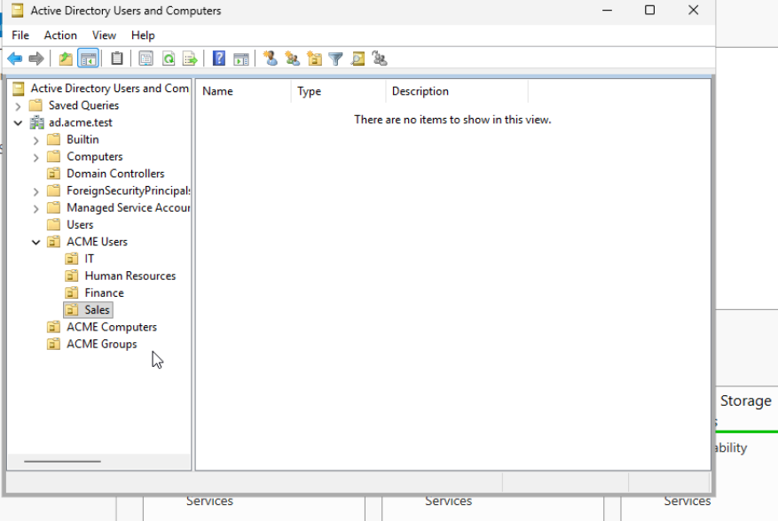
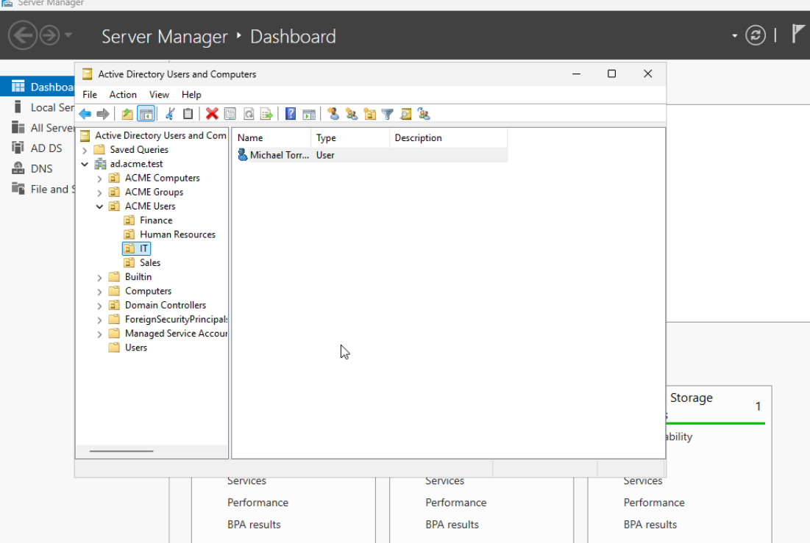
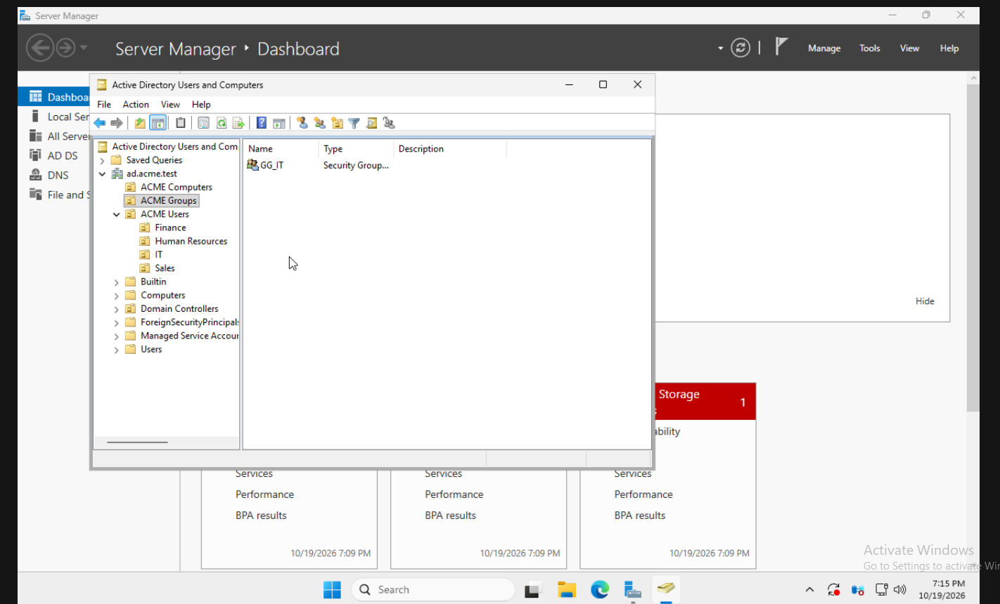
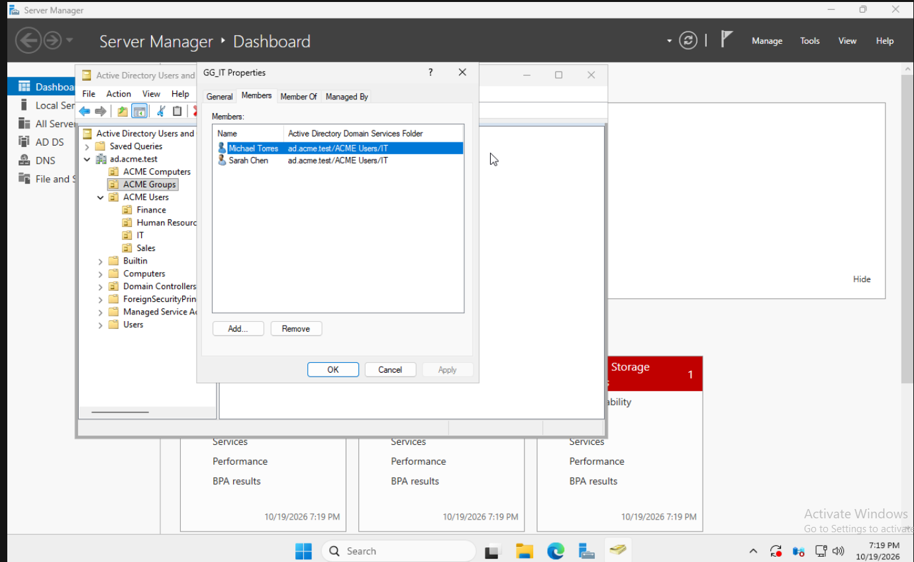
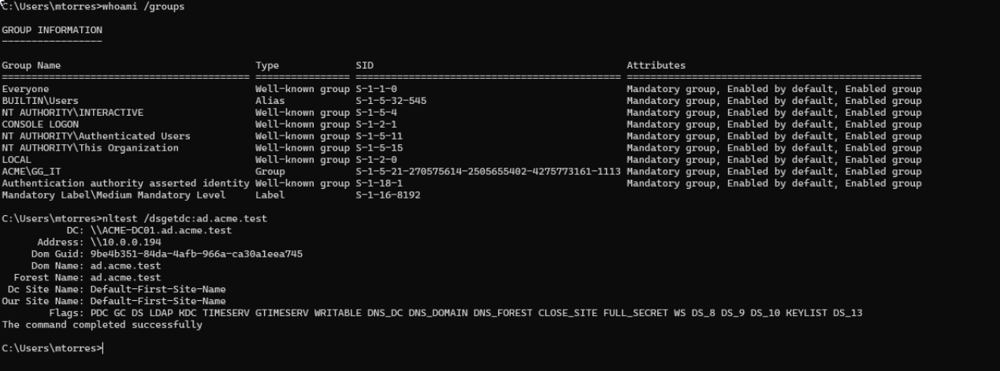

# 03 - Users and Security Groups

## Objective

Practice creating and organizing employee accounts in Active Directory, assigning departmental security groups, and verifying that group membership is available to users when they sign in to a domain-joined Windows 11 workstation.

This is a **simulated ACME Corporation environment** built for hands-on help desk and Windows administration experience.

## Environment

| Component | Configuration |
|---|---|
| Domain | `ad.acme.test` |
| Domain controller | `ACME-DC01` — Windows Server 2025 |
| Domain-joined workstation | `ACME-PC-001` — Windows 11 Pro |
| Directory tool | Active Directory Users and Computers (ADUC) |
| Organizational units | `ACME Users`, `ACME Groups` |
| Groups | Global security groups for each department |

## 1. Organize Departments into Organizational Units

Used **Active Directory Users and Computers** to create an `ACME Users` OU and four department OUs: **IT**, **Human Resources**, **Finance**, and **Sales**. Created a separate `ACME Groups` OU for departmental security groups.

```text
ad.acme.test
├── ACME Users
│   ├── IT
│   ├── Human Resources
│   ├── Finance
│   └── Sales
├── ACME Groups
└── ACME Computers
```



## 2. Provision Employee User Accounts

Created eight simulated employee accounts, placing each user into the appropriate department OU.

| Department | Employee | User logon name |
|---|---|---|
| IT | Michael Torres | `mtorres` |
| IT | Sarah Chen | `schen` |
| Human Resources | Emily Davis | `edavis` |
| Human Resources | Jessica Miller | `jmiller` |
| Finance | David Wilson | `dwilson` |
| Finance | Lisa Anderson | `landerson` |
| Sales | John Smithy | `jsmithy` |
| Sales | Robert Taylor | `rtaylor` |

### Account Provisioning Workflow

In **ADUC**, selected the appropriate departmental OU, then used **New → User** to enter the employee's name and user logon name. Assigned a temporary password and selected **User must change password at next logon** as part of the account-provisioning workflow.

Employee accounts were configured as standard domain users rather than added to privileged groups such as **Domain Admins**.

The screenshot below documents creation of Michael Torres in the IT OU as a representative example. Not every employee account is individually pictured.



## 3. Create Departmental Security Groups

Created department-oriented security groups in the `ACME Groups` OU, using **Global** scope and **Security** type. The `GG_` prefix identifies the intended Global Group naming convention.

| Security group | Department | Intended members |
|---|---|---|
| `GG_IT` | IT | Michael Torres; Sarah Chen |
| `GG_HR` | Human Resources | Emily Davis; Jessica Miller |
| `GG_Finance` | Finance | David Wilson; Lisa Anderson |
| `GG_Sales` | Sales | John Smithy; Robert Taylor |

The `GG_IT` group creation is shown below as an example.



### Assign Users to Security Groups

For each group, opened **Properties → Members → Add**, selected the matching department accounts, and confirmed the membership.

The `GG_IT` properties screenshot shows **Michael Torres** and **Sarah Chen** as members.



## 4. Verify Group Membership from a Domain Workstation

After joining the Windows 11 workstation to the domain, signed in as a standard domain user and ran:

```cmd
whoami
whoami /groups
```

For Michael Torres, `whoami` returned `acme\mtorres`, and the group information listed `ACME\GG_IT`. This confirms the IT security group was included in the user's logon token.



Also checked a Sales user session with:

```cmd
gpresult /scope user /r
```

The output for `ACME\jsmithy` showed the user located in the **Sales OU** and listed `GG_Sales` among the account's security groups. The same output also shows the Sales GPO; GPO configuration and access restrictions are documented separately in **05 - Group Policy Management**.


## 5. Access Management Principles

- Kept everyday employee accounts separate from privileged administrator accounts.
- Organized user objects into departmental OUs to simplify administration.
- Used security groups to represent departments instead of assigning access to users individually.
- Verified membership through both ADUC and the signed-in Windows user's group information.

**Scope note:** Group creation and membership are demonstrated here. Resource-specific permissions (such as NTFS ACLs granting folder access to these groups) are not part of this section.

## Skills Demonstrated

- Active Directory user account provisioning
- Organizational Unit administration
- Departmental user organization
- Global security group creation
- Group membership management
- Least-privilege account separation
- Windows domain sign-in and `whoami /groups` verification
- Windows Group Policy result inspection with `gpresult`
- Technical documentation and screenshot evidence

## Outcome

Organized **eight simulated employees across four departments**, established department-based security groups, and demonstrated that the IT and Sales group memberships are recognized within domain user sessions on `ACME-PC-001`.

This provides a foundation for later Active Directory tasks, including Group Policy targeting and access management.
