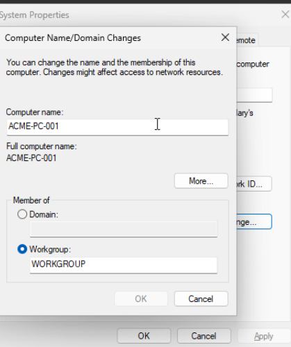
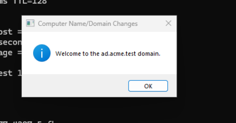
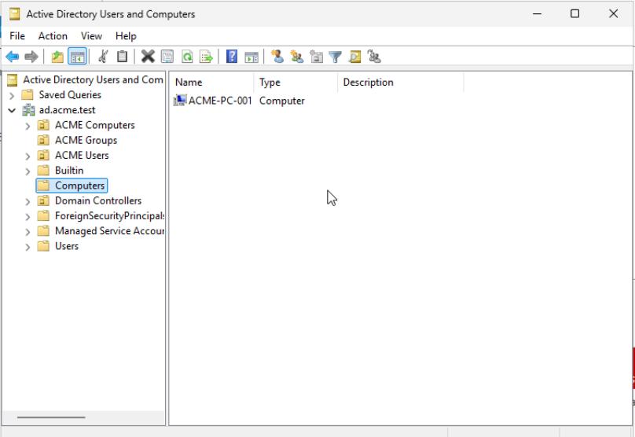
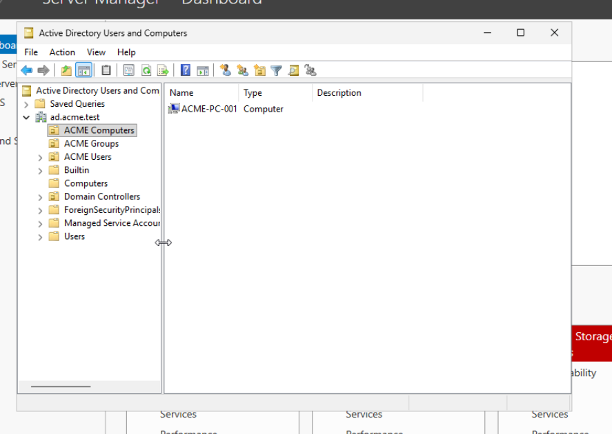
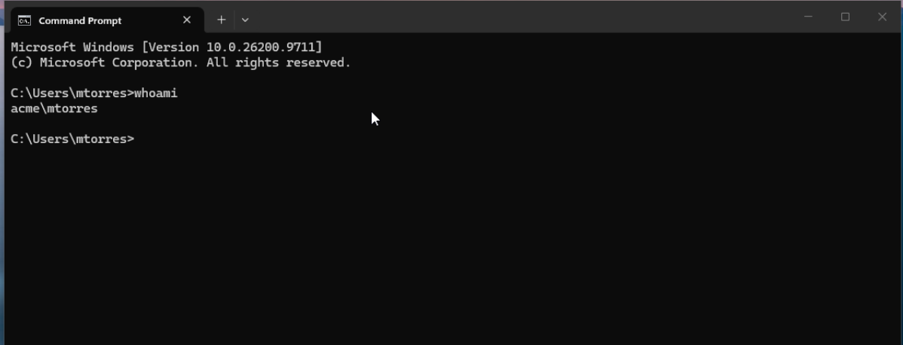

# 04 - Domain-Joined Workstation

## Objective

Join an existing **Windows 11 Pro** workstation to the Active Directory domain `ad.acme.test`, organize the computer object in a workstation Organizational Unit (OU), and verify that employees can authenticate through the domain controller.

This lab simulates onboarding a company workstation in **ACME Corporation**, using the domain controller and user accounts configured in earlier sections.

## Environment

| Component | Configuration |
|---|---|
| Domain | `ad.acme.test` (NetBIOS: `ACME`) |
| Domain controller / DNS | `ACME-DC01` — Windows Server 2025 |
| Domain controller IPv4 | `10.0.0.194` |
| Client workstation | `ACME-PC-001` — Windows 11 Pro |
| Workstation IPv4 | `10.0.0.5` |
| Network subnet | `10.0.0.0/24` |
| Computer OU | `ad.acme.test/ACME Computers` |
| Test domain account | `ACME\mtorres` — Michael Torres |
| Department security group | `ACME\GG_IT` |

## 1. Prepare Workstation Networking

Before joining the domain, ensured the Windows 11 workstation could reach `ACME-DC01` and query its Active Directory DNS service. Configured the workstation to use `10.0.0.194` as its preferred IPv4 DNS server while continuing to obtain its IP configuration from the existing DHCP service.

Example diagnostics used during preparation:

```cmd
ping 10.0.0.194
nslookup ad.acme.test 10.0.0.194
```

**Why DNS matters:** Windows domain joining and authentication rely on Active Directory DNS records to discover available domain controllers. Using only an external DNS resolver may prevent the workstation from finding `ad.acme.test`.

## 2. Join ACME-PC-001 to the Domain

On the Windows 11 workstation, opened **System Properties** (`sysdm.cpl`) → **Computer Name** → **Change**, selected **Domain**, and entered `ad.acme.test`.



When prompted, supplied authorized domain administrator credentials to complete the join operation. Windows displayed **“Welcome to the ad.acme.test domain.”**



Restarted the workstation to apply the new domain membership.

## 3. Organize the Workstation in Active Directory

On `ACME-DC01`, opened **Active Directory Users and Computers**. The newly joined `ACME-PC-001` computer account appeared in the domain's default **Computers** container.



Moved the computer object into the dedicated **ACME Computers** OU using **Move** in ADUC. This OU enables workstation-specific Group Policy Objects to be linked without targeting domain controllers.



### Resulting Structure

```text
ad.acme.test
├── ACME Computers
│   └── ACME-PC-001
├── ACME Groups
├── ACME Users
│   ├── IT
│   ├── Human Resources
│   ├── Finance
│   └── Sales
└── Domain Controllers
    └── ACME-DC01
```

## 4. Test Domain User Authentication

On `ACME-PC-001`, selected **Other user** at the Windows sign-in screen and authenticated with the previously created standard domain account `ACME\mtorres` (Michael Torres).

After the initial sign-in and user profile creation, opened Command Prompt and ran:

```cmd
whoami
```

The result was:

```text
acme\mtorres
```

This confirmed that the signed-in Windows session was using Michael Torres's **domain account**, rather than a preexisting local account.



## 5. Verify Group Membership and Domain Controller Discovery

While signed in as `ACME\mtorres`, ran:

```cmd
whoami /groups
nltest /dsgetdc:ad.acme.test
```

The results showed:

- `ACME\GG_IT` in the user's security groups, verifying IT group membership in the logon session.
- Domain controller discovery succeeded, returning `ACME-DC01.ad.acme.test` at `10.0.0.194`.
- The resolved domain and forest were `ad.acme.test`.


These results show both that the user is recognized by the domain and that the workstation can discover the domain controller through Active Directory infrastructure.

## 6. Administration and Security Considerations

- Used an authorized administrator account to join the workstation to the domain; regular employee accounts were not granted administrator access.
- Kept preexisting **local** Windows accounts separate from **domain** accounts. Joining the domain does not automatically convert an existing local profile into a domain profile.
- Located the client computer in a dedicated OU so workstation policies can be applied to the correct computer scope.
- Maintained DNS resolution through the Active Directory DNS server while leaving the home network's router DHCP service in place.

**Scope note:** This section demonstrates the workstation join, computer-object placement, domain login, group recognition, and domain-controller discovery. Configuration of Group Policy and policy enforcement is documented separately in **05 - Group Policy Management**.

## Skills Demonstrated

- Windows 11 domain joining
- Active Directory computer object management
- Organizational Unit placement
- DNS preparation for domain clients
- Domain-user authentication and profile setup
- Active Directory group membership validation
- `whoami`, `whoami /groups`, and `nltest` diagnostics
- Separation of local and domain user accounts
- Technical documentation with screenshot evidence

## Outcome

Successfully joined **ACME-PC-001** to the `ad.acme.test` Active Directory domain, moved it into the **ACME Computers** OU, and signed in as a standard domain user. Command-line checks verified the user's IT security group membership and successful discovery of **ACME-DC01** as the domain controller.
