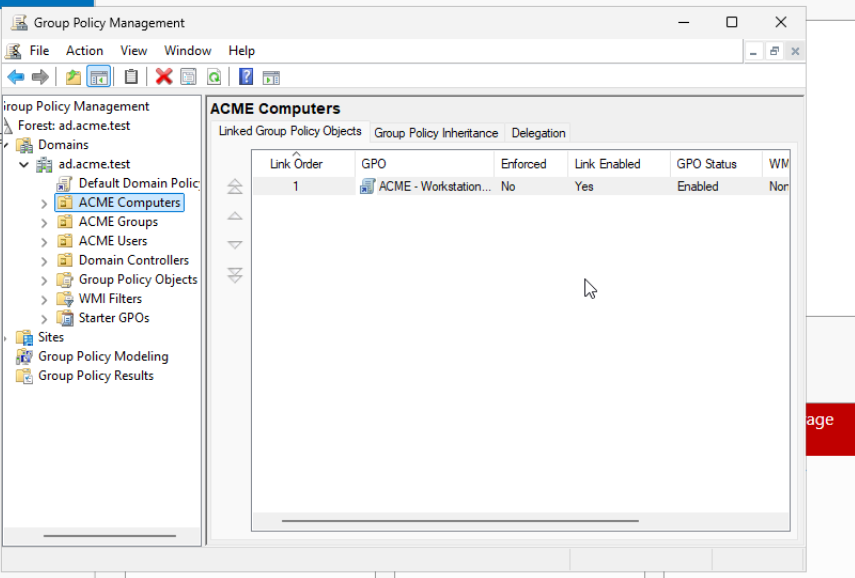
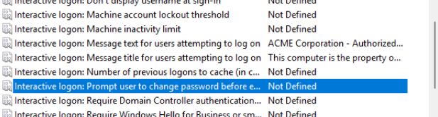
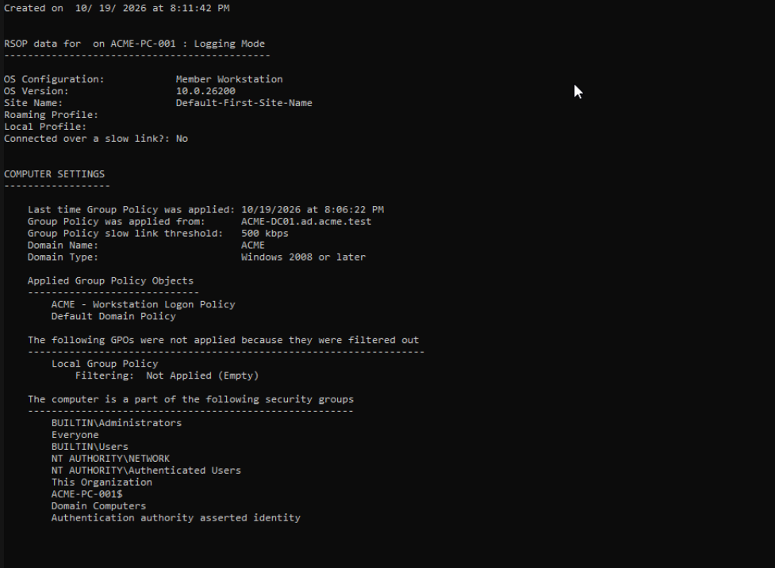
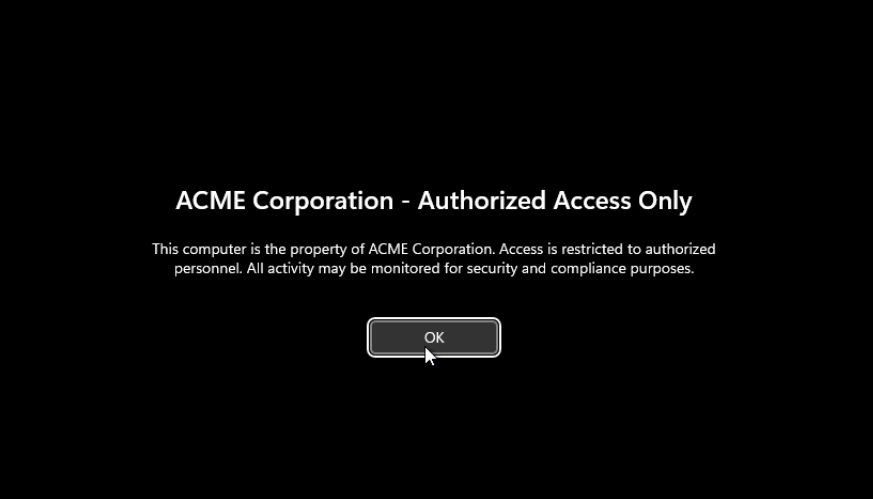
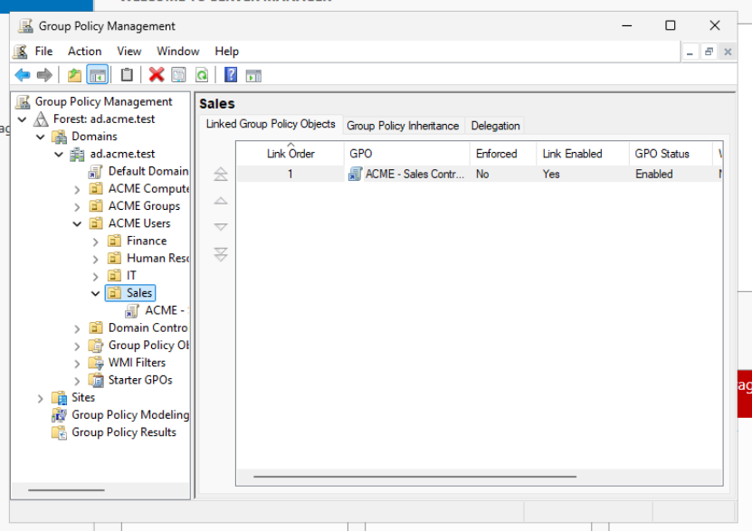
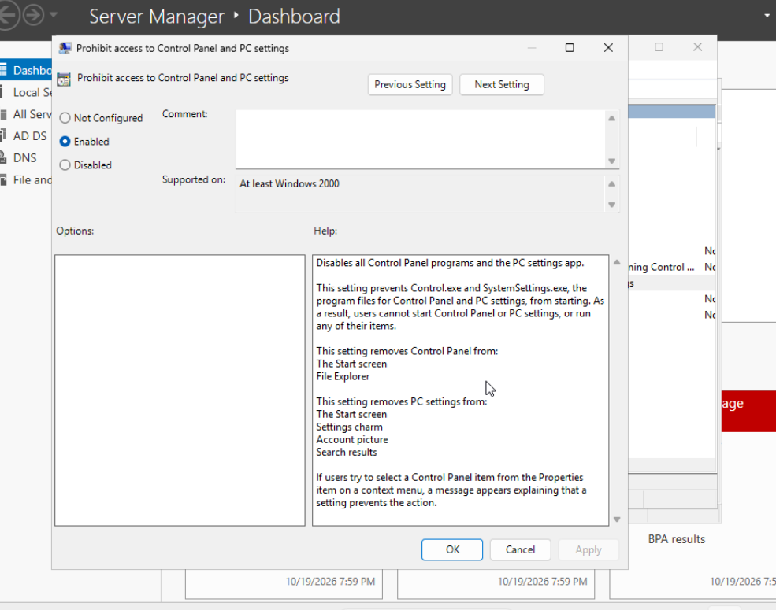
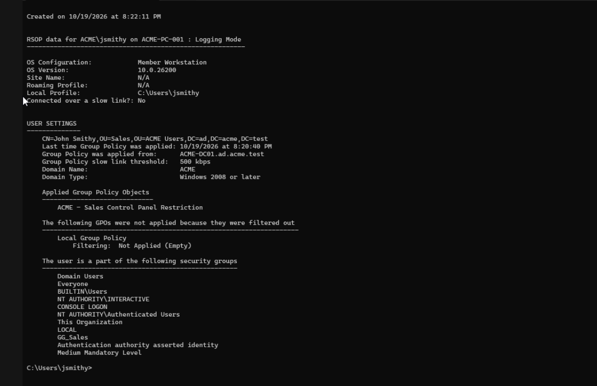
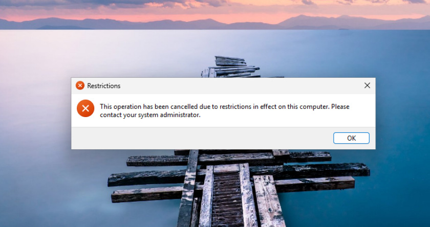

# Section 05 - Group Policy Management

## Overview

This section documents two Group Policy Objects (GPOs) configured in a simulated ACME Corporation Active Directory environment. The exercises demonstrate computer-scoped configuration, department-specific user policies, Group Policy processing, and troubleshooting with Windows command-line tools.

## Lab Environment

| Component | Configuration |
|---|---|
| Active Directory domain | `ad.acme.test` |
| Domain controller | `ACME-DC01` (Windows Server 2025) |
| Domain-joined workstation | `ACME-PC-001` (Windows 11 Pro) |
| Workstation OU | `ACME Computers` |
| Sales employee OU | `ACME Users/Sales` |
| Test accounts | `ACME\mtorres` (IT); `ACME\jsmithy` (Sales) |
| Sales security group | `GG_Sales` |

## Exercise 01 - Workstation Logon Notice

### Objective

Centrally configure a company notice to appear before users sign in to the domain-joined workstation.

### Configuration

1. On `ACME-DC01`, opened **Server Manager > Tools > Group Policy Management**.
2. Created the **ACME - Workstation Logon Policy** GPO and linked it to the **ACME Computers** OU containing `ACME-PC-001`.
3. Edited the GPO at:

   `Computer Configuration > Policies > Windows Settings > Security Settings > Local Policies > Security Options`

4. Defined these two settings:

   - **Interactive logon: Message title for users attempting to log on**
   - **Interactive logon: Message text for users attempting to log on**

The intended title and notice are:

**Title:** `ACME Corporation - Authorized Access Only`

**Text:** `This computer is the property of ACME Corporation. Access is restricted to authorized personnel. All activity may be monitored for security and compliance purposes.`





> **Troubleshooting note:** The initial policy settings screenshot captured the title and message text reversed. I corrected the two settings on `ACME-DC01`, refreshed policy on `ACME-PC-001`, and verified the corrected title and notice appeared before Windows sign-in. The original policy settings screenshot is retained to document the troubleshooting process.

### Verification

On `ACME-PC-001`, refreshed Group Policy and restarted the workstation:

```cmd
gpupdate /force
```

Checked the computer policy results:

```cmd
gpresult /scope computer /r
```

The output identified **ACME - Workstation Logon Policy** under **Applied Group Policy Objects** and showed the policy was applied from `ACME-DC01.ad.acme.test`. After correcting the message title and text placement, I verified that the authorized-access notice appeared in the intended format before Windows sign-in.





## Exercise 02 - Sales Control Panel Restriction

### Objective

Restrict Control Panel and Windows Settings for Sales employees while targeting the Sales user OU rather than the entire domain.

### Configuration

1. Opened **Group Policy Management** on `ACME-DC01`.
2. Created **ACME - Sales Control Panel Restriction** and linked it to `ACME Users/Sales`.
3. Kept the existing OU-based scope; no domain-wide restriction was configured.
4. Edited:

   `User Configuration > Policies > Administrative Templates > Control Panel`

5. Set **Prohibit access to Control Panel and PC settings** to **Enabled**.





### Verification

1. Signed into `ACME-PC-001` as Sales employee `ACME\jsmithy`.
2. Refreshed Group Policy and verified results using:

   ```cmd
   gpupdate /force
   gpresult /scope user /r
   ```

3. Confirmed that **ACME - Sales Control Panel Restriction** appeared in **Applied Group Policy Objects**. The output also showed membership in `GG_Sales`.
4. Attempted to access Control Panel. Windows displayed a restriction dialog explaining that the operation was cancelled due to restrictions on the computer.





The functional test confirms the restriction for the Sales test user. The GPO was linked to the Sales OU, so IT users in a separate OU were not targeted by this GPO link. A separate screenshot demonstrating unrestricted IT access was **not** captured for this section.

## Skills Demonstrated

- Group Policy Management Console (GPMC)
- Creation, editing, and linking of GPOs
- Computer Configuration vs. User Configuration
- OU-based policy targeting
- Administrative Templates and Security Options
- Group Policy refresh with `gpupdate /force`
- Resultant Set of Policy inspection with `gpresult`
- Validation of intended user restrictions
- Screenshot-based change verification and technical documentation

## Outcome

Created and linked a workstation logon GPO and a department-scoped Sales restriction GPO. Verified both objects appeared in applied policy results and confirmed that Windows blocked a Sales user's Control Panel operation.

After correcting the initial reversed title and text, the workstation displayed the intended ACME Corporation authorized-access notice before sign-in. This confirms the final computer-scoped GPO configuration was applied and produced the expected user-facing result.
