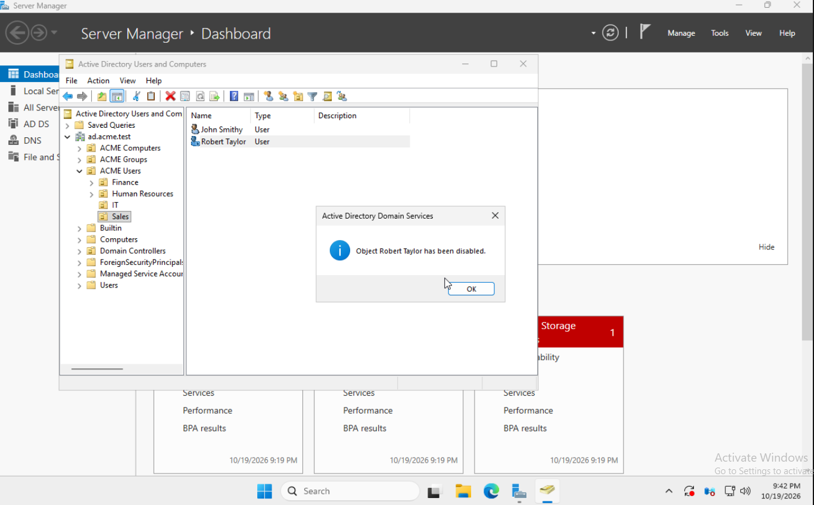
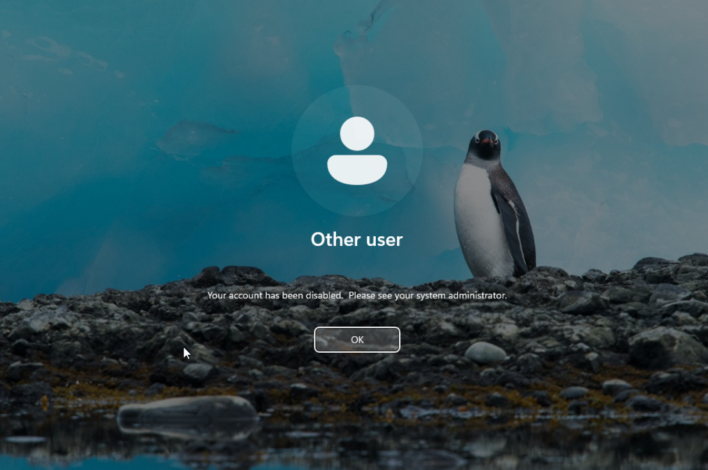
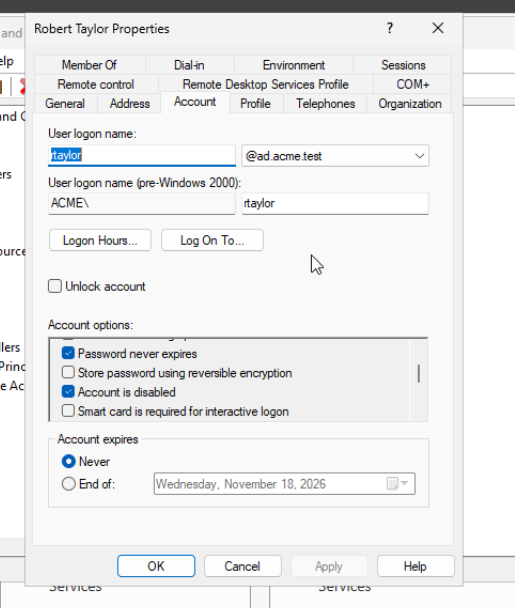
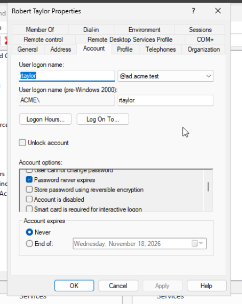
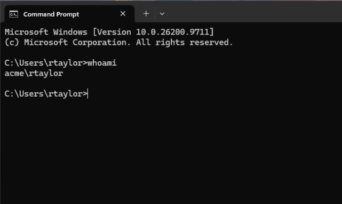

# Scenario 01 - Disabled User Account

## Incident Summary

**Simulated request:** Robert Taylor, a Sales employee, is unable to sign in to the company Windows 11 workstation.

| Field | Detail |
|---|---|
| Category | Identity and access / Windows sign-in |
| Domain | `ad.acme.test` (`ACME`) |
| Domain controller | `ACME-DC01` (Windows Server 2025) |
| Client | `ACME-PC-001` (Windows 11 Pro) |
| Test employee | Robert Taylor — `ACME\rtaylor` |
| Department / OU | `ACME Users / Sales` |
| Status | Resolved; successful domain sign-in verified |

## Objective

Simulate a disabled Active Directory user, reproduce the associated Windows sign-in error, identify the cause using Active Directory Users and Computers, restore the account, and verify access is recovered.

> **Training environment:** The account was intentionally disabled in an isolated homelab to produce a reproducible incident. In a workplace, first verify the caller's identity and confirm the account is authorized to be re-enabled, especially if a security or HR process may have disabled it.

## 1. Reproduce the Issue

On `ACME-DC01`, opened **Server Manager > Tools > Active Directory Users and Computers**, then navigated to:

`ad.acme.test > ACME Users > Sales > Robert Taylor`

Right-clicked the simulated employee account and selected **Disable Account**. Active Directory displayed **"Object Robert Taylor has been disabled."**



On the domain-joined workstation `ACME-PC-001`, attempted to sign in using `ACME\rtaylor`. Windows rejected the attempt with:

> Your account has been disabled. Please see your system administrator.



## 2. Investigate and Identify the Root Cause

Returned to `ACME-DC01`, opened **Robert Taylor > Properties > Account**, and inspected **Account options**.

The **Account is disabled** option was checked, matching the Windows sign-in error.



**Root cause:** The user object was explicitly marked as disabled in Active Directory. This was not a DNS problem, bad password, or workstation connectivity error in this simulation.

## 3. Resolve the Incident

On the same **Account** tab:

1. Cleared **Account is disabled**.
2. Saved the account changes.
3. Reopened/inspected the account options to confirm the setting was no longer checked.



**Action taken:** Restored the simulated employee's ability to authenticate by re-enabling their existing domain user object. No password reset or workstation rejoin was necessary.

## 4. Verify the Resolution

On `ACME-PC-001`, signed in successfully as `ACME\rtaylor`. Opened Command Prompt in that session and ran:

```cmd
whoami
```

**Observed result:**

```text
acme\rtaylor
```



This verifies the Windows session was established under Robert Taylor's domain identity after the account was re-enabled.

## Results

| Check | Observed result |
|---|---|
| AD confirms simulated account disabled | Passed |
| Windows displays disabled-account sign-in error | Passed |
| ADUC account properties show disabled flag | Passed |
| Disabled flag cleared and saved | Passed |
| Successful sign-in and `whoami` shows `acme\rtaylor` | Passed |

**Final status:** Resolved and verified.

## Skills Demonstrated

- User account administration with Active Directory Users and Computers
- Diagnosis of disabled-user authentication failures
- Understanding of account status versus password or network failures
- Re-enabling an authorized domain user account
- Windows domain sign-in and identity verification with `whoami`
- Incident lifecycle documentation with screenshots and reproducible evidence

## Key Takeaway

A disabled Active Directory user account prevents domain sign-in even when the account exists and the password is known. Inspecting the account's status in ADUC provides a direct way to validate this specific failure; after authorized re-enablement, a successful Windows sign-in and `whoami` output provide useful verification that access has been restored.
